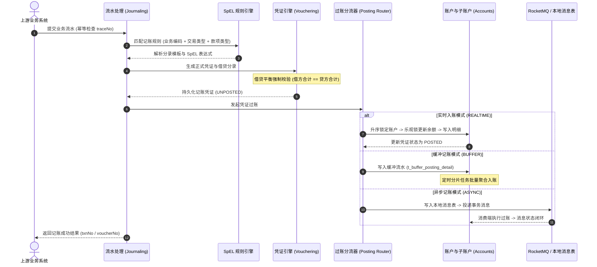

<div align="center">

# 🏦 FIN-Core · 金融级智能账务核心系统
### Smart Accounting Engine

[](https://opensource.org/licenses/Apache-2.0)
[](https://adoptium.net/)
[](https://spring.io/projects/spring-boot)
[](https://spring.io/projects/spring-cloud)
[](https://vuejs.org/)
[](https://vitejs.dev/)
[](https://rocketmq.apache.org/)
[](https://www.xuxueli.com/xxl-job/)
[](CONTRIBUTING.md)

**高可靠 · 高并发 · 遵循现代会计准则 · 金融级双录复式记账核心引擎**

[English](README_EN.md) | [简体中文](README.md) | [快速上手](#quick-start) | [贡献指南](CONTRIBUTING.md) | [架构设计](docs/)

</div>

---

## 📖 项目简介

**FIN-Core** 是一套面向银行、消费金融、互联网金融、第三方支付及电商大促场景打造的高性能、企业级**金融账务核心系统（Accounting Core Engine）**。

传统业务系统常将账务逻辑分散在业务代码中，通过 `UPDATE balance = balance - 100` 等硬编码方式直接改动余额，面临**缺乏借贷平衡约束、账实无法核对、热点账户行锁严重竞争、缺乏完整凭证审计链、无日切试算平衡机制**等致命隐患。

**FIN-Core** 严格遵循现代会计学复式记账准则与国家金融监管规范，构建了从**业务流水入库 → 规则引擎动态解析 → 凭证与分录生成（借贷平衡强校验） → 多模式过账引擎（实时 / 缓冲 / 异步） → 双子账户更新 → 瞬时切日与日终 8 步自动核算**的全链路闭环解决方案。

---

## 🌟 核心特性与亮点

### 1. 严格遵循现代会计准则（Financial Accounting Standards）
- **复式记账（Double-Entry）**：有借必有贷，借贷必相等。全链路分录级别实时强制校验借贷双方金额绝对平衡。
- **先证后账（Voucher First）**：账户余额不能随意被业务驱动，必须先生成唯一凭证号的正式记账凭证（`Voucher`）与分录（`Entry`），凭证校验通过后方可执行过账更新账本。
- **红蓝字冲账（Reversal）**：严禁物理删除或直接 UPDATE 已入账凭证。调账通过生成全量反向分录的冲账凭证，原凭证标记为 `REVERSED`，冲账凭证标记为 `POSTED`，实现不可篡改的全流程审计轨迹。

### 2. 独创“主账户 + 双子账户”资产模型
- **主账户（Account）**：承载全局汇总账面余额、币种、科目归属、所有者及风控状态（正常/止入/止出/双向冻结）。
- **双子账户体系（Sub-Account）**：
  - **可用子账户（AVAILABLE）**：支持正常充值、消费、放款、扣款变动；
  - **冻结子账户（FROZEN）**：专门承载司法冻结、交易预授权冻结、风控冻结金额；
- **资金动作原子解耦**：
  - **资金冻结**：可用子账户余额转移至冻结子账户，主账户总余额保持不变；
  - **资金解冻**：冻结子账户余额转回可用子账户；
  - **冻结扣款**：直接从冻结子账户扣减并同步减少主账户余额，自动生成正式扣款凭证与双明细流水；
  - **超时自动解冻**：基于 XXL-JOB 定时扫描到期冻结明细，防止资金无限期挂起。

### 3. 应对极端高并发的三种入账模式（Posting Modes）
针对电商大促、平台手续费账户、商户备付金等极高频热点动账场景，FIN-Core 提供多层次入账策略，彻底告别单点行锁阻塞：
- **实时入账（REALTIME）**：面向普通低频交易，同步生成凭证并执行乐观锁扣划，实时性高（P99 < 50ms）。
- **缓冲记账（BUFFER）**：针对高并发热点账户，交易到达时仅持久化缓冲入账明细（`t_buffer_posting_detail`），由后台异步任务或分片 Job 按时间窗口自动合并，将 10,000 次行锁竞争收敛为 1 次批量聚合入账。
- **异步记账（ASYNC）**：基于 **RocketMQ + Transactional Outbox（本地消息表）**，通过可靠事务消息驱动后台消费者平滑削峰过账，单笔失败自动触发反向凭证回滚或指数退避重试，保障跨系统最终一致性。

### 4. SpEL 规则引擎与多款项聚合分录
- **零硬编码**：科目号、借贷方向、金额计算逻辑全量外置，业务与财务系统彻底解耦。
- **动态 SpEL 公式计算**：支持在分录明细中配置 Spring Expression Language（SpEL）公式，根据流水上送的交易金额、附加费、分期期数等动态求值。
- **多款项聚合入账（Multi-FundsType）**：在信贷还款或复杂结算场景下，支持将单笔流水中包含的“本金 + 利息 + 担保费”聚合入账至同一银行存款借方，并将“实收利息 + 减免利息”聚合冲销应收利息贷方，保持标准财务凭证的整洁与权威性。

### 5. 瞬时切日与日终 8 步自动核算（EOD Engine）
- **瞬时切日（Zero-Downtime Date Switch）**：采用 `Caffeine L1 + Redis L2 + Redis Pub/Sub` 广播架构，全系统微秒级切换会计日期（T+1），业务系统 7×24 小时不间断对外服务。
- **日终 8 步全自动化流水线**：
  $$\text{切日} \rightarrow \text{缓冲清理} \rightarrow \text{日余额汇总} \rightarrow \text{日/月快照} \rightarrow \text{试算平衡} \rightarrow \text{总分核对} \rightarrow \text{余额核对} \rightarrow \text{期末结转} \rightarrow \text{冷热归档}$$
- **试算平衡（Trial Balance）**：严格校验 $\sum \text{期末借方余额} = \sum \text{期末贷方余额}$，差额阈值控制在 $0.000001$，若不平衡实时阻断日终流程并告警。
- **期末损益结转**：基于科目通配符规则，自动将收入、费用类科目余额批量生成结转凭证平移至本年利润。

### 6. 金融级防御性架构约束
- **绝对值法则**：全系统分录与流水金额强制大于 0（`BigDecimal > 0`），严禁负数运算。
- **严禁 SQL 计算余额**：余额必须在领域模型中计算，并通过数据库乐观锁（`version` 版本号）保障原子更新。
- **事务精确控制**：全系统严禁声明式 `@Transactional`（杜绝长事务与动态代理失效），必须使用 `TransactionTemplate` 显式控制事务生命周期。
- **有序加锁防死锁**：多账户并行划扣时，强制按照 `account_no` 字典升序申请 Redisson 分布式锁。

---

## 🏗️ 系统架构设计

### 1. 分层架构图

```mermaid
flowchart TD
    subgraph Client["接入与展示层 (Client Layer)"]
        UI["前端管理后台 (accounting-ui)<br/>Vue 3 + Vite 6 + Element Plus + Pinia"]
        GW["API Gateway / BFF<br/>OpenAPI 3.0 / Swagger"]
    end

    subgraph API["契约定义层 (accounting-api)"]
        DTO["Request / Response DTO"]
        ENUM["业务状态机与财务枚举"]
        ERR["全局金融错误码定义"]
    end

    subgraph Core["核心引擎层 (accounting-core)"]
        subgraph App["应用编排层 (Application Services)"]
            APP_JRN["流水编排 (Journaling)"]
            APP_VOU["凭证编排 (Vouchering)"]
            APP_POS["过账编排 (Posting)"]
            APP_EOD["日切核算 (EOD Engine)"]
            APP_ACT["账户资产 (Account/Freeze)"]
        end

        subgraph Domain["领域模型与服务层 (Domain Services)"]
            DOM_RULE["SpEL 记账规则引擎"]
            DOM_CALC["余额计算器 (绝对值法则+乐观锁)"]
            DOM_REV["红蓝字冲账服务"]
            DOM_RUN["Running Balance 流水对齐校验"]
            DOM_CACHE["会计日期多级缓存 (Caffeine+Redis)"]
        end

        subgraph Infra["基础设施与组件层 (Infrastructure)"]
            MYBATIS["MyBatis-Plus 3.5.9<br/>多租户拦截 + 乐观锁"]
            REDISSON["Redisson 4.8.0<br/>账户升序锁 + 字典二级缓存"]
            ROCKETMQ["Apache RocketMQ 5.x<br/>可靠事务消息 + 异步削峰"]
            OUTBOX["Transactional Outbox<br/>本地消息表一致性闭环"]
            XXLJOB["XXL-JOB 3.4.2<br/>日切/缓冲分片/自动解冻"]
        end
    end

    subgraph DB["数据持久层 (Storage)"]
        MYSQL[(MySQL 8.0 账务核心库)]
    end

    UI --> GW
    GW --> API
    API --> App
    App --> Domain
    Domain --> Infra
    Infra --> DB
```



### 2. 核心记账数据流转时序



---

## 📦 项目模块结构

```text
accounting
├── accounting-api          # 【契约层】对外 API 接口、Request/Response DTO、枚举字典与错误码（零持久层与中间件依赖）
├── accounting-core         # 【核心层】领域模型、SpEL 规则引擎、凭证过账引擎、日终核算、MQ 消费者、持久层与调度执行器
├── accounting-ui           # 【前端工程】现代化 Vue 3 + Vite 6 + TypeScript + Element Plus + Pinia 管理控制台
├── docker                  # 【部署套件】Docker Compose 生产级一键编排（MySQL 8, Redis 7.2, RocketMQ 5, Nacos 3, XXL-JOB）
├── docs                    # 【设计文档】架构蓝图、全量 SQL 迁移演进脚本、详细设计说明
├── pom.xml                 # 顶级 Maven 聚合 POM
├── CONTRIBUTING.md         # 社区贡献指南与财务规范
├── LICENSE                 # Apache License 2.0 开源协议
└── README.md               # 项目主说明文档
```

---

<span id="quick-start"></span>
## 🚀 5 分钟快速启动 (Quick Start)

### 环境依赖
- **后端运行**：JDK 17 或 21、Maven 3.8+
- **前端运行**：Node.js 18+ (推荐 20.x)、npm / pnpm
- **一键编排**：Docker Desktop 20.10+ / Docker Compose 2.0+

---

### 方式一：Docker Compose 一键启动（推荐 ⭐⭐⭐⭐⭐）

本项目提供开箱即用的一键部署套件，预置了所有数据库表结构、基础字典数据、Nacos 配置中心和 XXL-JOB 任务。

#### 1. 克隆代码仓库
```bash
git clone https://github.com/KayCheung/accounting.git
cd accounting
```

#### 2. 一键启动基础设施与全栈服务
- **Windows 环境**：
  双击运行或在 CMD / PowerShell 中执行：
  ```cmd
  cd docker
  start.bat
  ```
- **Linux / macOS 环境**：
  ```bash
  cd docker
  chmod +x start.sh stop.sh
  ./start.sh
  ```

脚本会自动检测编译状态，启动全部组件容器。

#### 3. 访问控制台与默认密码
启动完成后，可在浏览器中直接打开各服务：

| 服务名称 | 宿主机端口 | Web 访问入口 | 默认账号 / 密码 | 说明 |
|:---|:---|:---|:---|:---|
| **前端管理控制台** | `8000` | [http://localhost:8000](http://localhost:8000) | - | 账务核心管理端 |
| **后端 API (Swagger)** | `8080` | [http://localhost:8080/swagger-ui.html](http://localhost:8080/swagger-ui.html) | - | OpenAPI 3.0 接口文档 |
| **Nacos 配置中心** | `8848` | [http://localhost:8848/nacos](http://localhost:8848/nacos) | `dev` / `dev@kltb@2026` | 预置账务系统全量配置 |
| **RocketMQ 仪表盘** | `8088` | [http://localhost:8088](http://localhost:8088) | 无 | 消息轨迹与消费监控 |
| **XXL-JOB 调度中心** | `8082` | [http://localhost:8082/xxl-job-admin](http://localhost:8082/xxl-job-admin) | `admin` / `123456` | 日切、缓冲与解冻调度 |
| **MySQL 8.0** | `3306` | `localhost:3306` | `root` / `dev@1234` | 账务核心数据库 |
| **Redis 7.2** | `6379` | `localhost:6379` | 密码：`dev@1234` | 缓存与分布式锁 |

---

### 方式二：本地源码开发与调试

如果您需要进行深度定制或本地源码断点调试：

#### 1. 启动中间件
进入 `docker/` 目录，通过 docker-compose 单独拉起中间件组件（MySQL, Redis, RocketMQ, Nacos, XXL-JOB）：
```bash
cd docker
docker-compose up -d mysql redis rocketmq-namesrv rocketmq-broker nacos xxl-job-admin
```
*(注：MySQL 启动时会自动执行 `docker/mysql/init/` 下的 4 个初始化 SQL 脚本)*

#### 2. 编译并启动后端服务
```bash
# 根目录下安装父 POM 并编译 API
mvn clean install -DskipTests

# 启动 accounting-core 核心模块
cd accounting-core
mvn spring-boot:run
```

#### 3. 启动前端管理后台
```bash
cd accounting-ui
npm install
npm run dev
```
启动成功后，浏览器访问 [http://localhost:3000](http://localhost:3000) 即可进行界面操作。

---

## 🖥️ 管理后台系统全览

系统前端基于 **Vue 3 + Vite 6 + TypeScript + Element Plus** 构建，包含完备的金融会计管理界面：

| 功能板块 | 核心页面路由 | 核心业务能力 |
|:---|:---|:---|
| **系统概览** | `/dashboard` | 会计日权威展示、试算平衡实时指示灯、角色工作台（经办/初审/复核/记账）、业务流水与异常大盘 |
| **会计科目管理** | `/config/subject` | 资产/负债/权益树形科目表、懒加载全级次检索、辅助核算项绑定（客户/部门/项目） |
| **开户模板管理** | `/config/template` | 多业务线账户模板配置、账号/户名 SpEL 规则动态预览（`{subjectCode}`/`{currency}`/`{seq}`） |
| **记账规则配置** | `/config/rule` | 动态借贷分录配置、一借一贷/一借多贷、SpEL 动态求值脚本、多款项聚合映射 |
| **缓冲入账规则** | `/config/buffer-rule` | 逐条缓冲/日间批量/日终汇总规则配置、生效时间区间校验 |
| **账户资产管理** | `/business/account` | 客户分户与内部账户双视图、账户全景抽屉、总余额/可用/冻结卡片看板、账户状态机管控 |
| **余额与明细查询** | `/business/balance` | 4 维资产大盘、动账流水深层审计档案、卡片式金额变动对账（前余额 ± 变动 = 后余额） |
| **资金冻结与扣款** | `/business/freeze` | 可用资金冻结、支持全额/部分解冻、防超额冻结扣款并自动生成记账凭证 |
| **记账凭证管理** | `/business/voucher` | 凭证全景档案、分录借贷平衡校验指示灯、规范“收/付/转”凭证字号、全量辅助核算明细 |
| **日切与核算监控** | `/business/eod` | 瞬时切日控制台、8 步日终自动化状态追踪、试算平衡表、总分核对看板与期末结转 |

---

## ⚖️ 金融核心开发铁律（必读）

参与本项目贡献的开发者必须严格遵循以下原则，违者代码一律不予合并：

1. **绝对值法则**：全系统凭证金额与分录金额严格要求 `amount.compareTo(BigDecimal.ZERO) > 0`。
2. **严禁在 SQL 中计算余额**：禁止使用 `balance = balance + #{amount}`。所有余额计算必须在 Java 领域模型中执行，并通过 `version` 乐观锁更新数据库。
3. **严禁声明式事务注解 `@Transactional`**：统一使用 Spring 编程式事务 `TransactionTemplate`，明确界定事务边界，杜绝长事务造成连接池耗尽与死锁。
4. **多账户字典升序加锁**：若单笔事务涉及操作多个账户，获取分布式锁时必须按 `account_no` 字母升序依次加锁，从源头根绝循环死锁。
5. **严禁使用浮点数**：金额强制使用 `BigDecimal`，必须通过字符串构造器 `new BigDecimal(String)`，比较金额必须使用 `compareTo() == 0`，严禁使用 `equals()`。
6. **红冲不可撤销原则**：凭证一旦入账（POSTED），严禁删除和修改。调账必须走红字/蓝字反向冲销流程。

---

## 🤝 参与贡献 (Contributing)

我们非常欢迎来自社区的 Issue 与 Pull Request！

在提交代码前，请参阅完整的 [贡献指南 (CONTRIBUTING.md)](CONTRIBUTING.md) 了解分支规范、Commit Message 格式及代码测试要求。

```bash
# 提交前运行单元测试保证 100% 通过
mvn clean test

# 前端类型检查与构建验证
cd accounting-ui
npm run type-check
npm run build
```

---

## 📄 开源协议 (License)

本项目采用 [Apache License 2.0](LICENSE) 开源协议。

Copyright (c) 2026 **Zhang Kai (KayCheung)**. All rights reserved.
