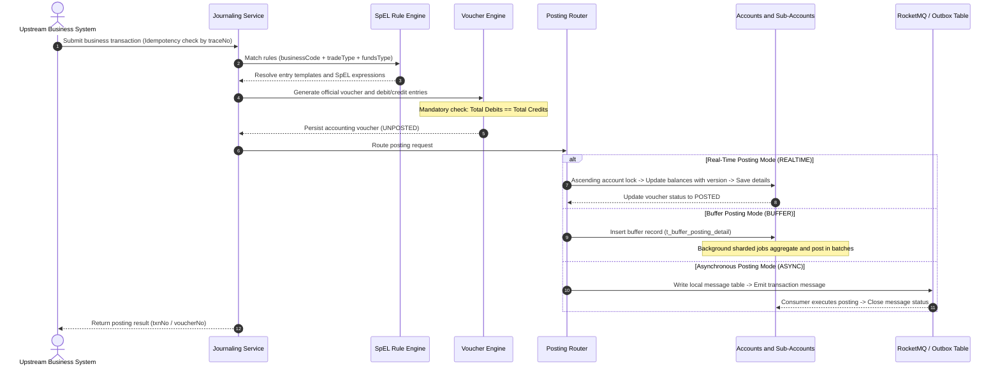

<div align="center">

# 🏦 FIN-Core · Smart Financial Accounting Engine

[](https://opensource.org/licenses/Apache-2.0)
[](https://adoptium.net/)
[](https://spring.io/projects/spring-boot)
[](https://spring.io/projects/spring-cloud)
[](https://vuejs.org/)
[](https://vitejs.dev/)
[](https://rocketmq.apache.org/)
[](https://www.xuxueli.com/xxl-job/)
[](CONTRIBUTING.md)

**High-Reliability · High-Concurrency · Modern Accounting Standards · Financial-Grade Double-Entry Core Engine**

[English](README_EN.md) | [简体中文](README.md) | [Quick Start](#quick-start) | [Contributing](CONTRIBUTING.md) | [Architecture](docs/)

</div>

---

## 📖 Introduction

**FIN-Core** is an enterprise-grade, high-performance financial accounting core engine designed for commercial banks, consumer finance, fintech, third-party payment platforms, and high-concurrency e-commerce flash-sale scenarios.

Traditional business systems often scatter accounting logic across application services, directly updating account balances via SQL statements like `UPDATE balance = balance - 100`. This approach creates critical vulnerabilities: **lack of double-entry debit-credit balancing, inability to reconcile transactions, severe row-lock contention on hot accounts, absence of immutable voucher audit trails, and missing automated End-of-Day (EOD) trial balance mechanisms**.

**FIN-Core** strictly adheres to modern accounting principles and financial regulatory standards. It provides a robust, end-to-end closed-loop solution:
$$\text{Business Journal} \longrightarrow \text{SpEL Rule Engine} \longrightarrow \text{Vouchers and Entries (Balanced)} \longrightarrow \text{Multi-Mode Posting Engine} \longrightarrow \text{Sub-Account Updates} \longrightarrow \text{Zero-Downtime EOD and Trial Balance}$$

---

## 🌟 Key Features and Highlights

### 1. Strict Adherence to Financial Accounting Standards
- **Double-Entry Bookkeeping**: "Every debit must have an equal credit." Strict entry-level balance verification guarantees total debits equal total credits for every transaction.
- **Voucher-First Posting**: Account balances are never directly modified. Every balance mutation requires an official accounting voucher (`AccountingVoucher`) and its entries (`AccountingVoucherEntry`). Posting is triggered only after full verification.
- **Red-Ink Reversal (Immutable Audit Trail)**: Recorded vouchers are strictly immutable—never physically deleted or updated. Adjustments and reversals are made by generating reversal vouchers with transposed debit/credit entries, preserving complete historical auditability.

### 2. Dual Sub-Account Asset Architecture
- **Master Account**: Tracks total book balance, currency, subject code, account ownership, and risk control statuses (`NORMAL`, `FREEZE_IN`, `FREEZE_OUT`, `FROZEN`).
- **Sub-Account Hierarchy**:
  - **Available Sub-Account (`AVAILABLE`)**: Handles routine credits, debits, payments, and loans.
  - **Frozen Sub-Account (`FROZEN`)**: Dedicated to judicial freezes, authorization holds, and risk holds.
- **Decoupled Financial Actions**:
  - **Fund Freeze**: Moves funds from Available to Frozen sub-accounts without altering total master account balance.
  - **Fund Unfreeze**: Transfers balance back from Frozen to Available sub-accounts.
  - **Freeze Deduction**: Deducts balance directly from Frozen sub-accounts while decreasing master balance, automatically generating standard vouchers and double-leg journal entries.
  - **Auto-Unfreeze Job**: XXL-JOB scheduled tasks automatically sweep and release expired frozen records.

### 3. Three Posting Modes for Extreme Concurrency
To mitigate row-lock contention on ultra-hot accounts (e.g., platform fee accounts, merchant escrow accounts), FIN-Core offers tiered posting mechanisms:
- **Real-Time Posting (`REALTIME`)**: For low-to-medium frequency transactions. Concurrently validates entries, locks accounts, and updates balances via optimistic locking (P99 < 50ms).
- **Buffer Posting (`BUFFER`)**: For ultra-high concurrency hot accounts. Requests write lightweight buffer records (`t_buffer_posting_detail`). Background jobs periodically aggregate hundreds or thousands of transactions into a single batch posting, turning massive lock contention into bulk throughput.
- **Asynchronous Posting (`ASYNC`)**: Built on **Apache RocketMQ + Transactional Outbox (Local Message Table)**. Smoothly absorbs traffic spikes while guaranteeing eventual consistency across distributed microservices.

### 4. Dynamic SpEL Rule Engine and Multi-Funds Aggregation
- **Zero Hardcoding**: Subject codes, debit/credit directions, and calculations are completely externalized from code.
- **Dynamic Formula Evaluation**: Evaluates Spring Expression Language (SpEL) scripts at runtime, computing amounts from transaction payload attributes (e.g., base amount, handling fee, installments).
- **Multi-Funds Aggregation**: In loan repayment or multi-party settlement scenarios, multiple funds (e.g., Principal + Interest + Guarantee Fee) can be dynamically aggregated into a single bank deposit debit entry, keeping financial vouchers concise and readable.

### 5. Zero-Downtime Date Switch and Automated 8-Step EOD Engine
- **Instant Accounting Date Switch**: Powered by `Caffeine L1 + Redis L2 + Redis Pub/Sub`, switching accounting date ($T+1$) in microseconds with 24/7 service availability.
- **Automated 8-Step EOD Pipeline**:
  $$\text{Date Switch} \rightarrow \text{Buffer Flush} \rightarrow \text{Daily Balance Aggregation} \rightarrow \text{Snapshots} \rightarrow \text{Trial Balance} \rightarrow \text{Ledger Verification} \rightarrow \text{Balance Verification} \rightarrow \text{Period-End Closing} \rightarrow \text{Archival}$$
- **Trial Balance Verification**: Strictly asserts $\sum \text{Debit Balances} = \sum \text{Credit Balances}$ with an error tolerance under $0.000001$. Any imbalance triggers immediate alerts and halts the pipeline.
- **Period-End Profit and Loss Closing**: Automatically sweeps revenue and expense balances into Retained Earnings via wildcard rule-based closing vouchers.

### 6. Financial-Grade Defensive Architecture
- **Absolute Value Law**: All voucher and journal amounts must be strictly positive (`BigDecimal > 0`). Negative operations are strictly prohibited.
- **No In-SQL Balance Math**: Balances must be computed within domain models and updated via optimistic locking (`version`).
- **Explicit Transaction Demarcation**: Prohibits `@Transactional` annotations to prevent long-lived transactions, deadlocks, and proxy failures; strictly requires `TransactionTemplate`.
- **Lexicographical Lock Ordering**: When locking multiple accounts, distributed locks (Redisson) must be acquired in ascending lexicographical order of `account_no`.

---

## 🏗️ Architecture and Workflows

### 1. Layered Architecture

```mermaid
flowchart TD
    subgraph Client["Client and Presentation Layer"]
        UI["Management Console (accounting-ui)<br/>Vue 3 + Vite 6 + Element Plus + Pinia"]
        GW["API Gateway / BFF<br/>OpenAPI 3.0 / Swagger"]
    end

    subgraph API["Contract Layer (accounting-api)"]
        DTO["Request / Response DTOs"]
        ENUM["Financial Enums and State Machines"]
        ERR["Global Financial Error Codes"]
    end

    subgraph Core["Core Engine (accounting-core)"]
        subgraph App["Application Orchestration Layer"]
            APP_JRN["Journaling Orchestration"]
            APP_VOU["Vouchering Orchestration"]
            APP_POS["Posting Orchestration"]
            APP_EOD["EOD Engine Orchestration"]
            APP_ACT["Account and Freeze Services"]
        end

        subgraph Domain["Domain Services and Models"]
            DOM_RULE["SpEL Accounting Rule Engine"]
            DOM_CALC["Balance Calculator (Optimistic Lock)"]
            DOM_REV["Reversal and Red-Ink Service"]
            DOM_RUN["Running Balance Validator"]
            DOM_CACHE["Multi-Level Date Cache (Caffeine + Redis)"]
        end

        subgraph Infra["Infrastructure Layer"]
            MYBATIS["MyBatis-Plus 3.5.9<br/>Multi-Tenant + Optimistic Locking"]
            REDISSON["Redisson 4.8.0<br/>Ordered Distributed Locks + Caches"]
            ROCKETMQ["Apache RocketMQ 5.x<br/>Reliable Messaging and De-peaking"]
            OUTBOX["Transactional Outbox<br/>Local Message Consistency"]
            XXLJOB["XXL-JOB 3.4.2<br/>EOD / Buffer Shards / Auto-Unfreeze"]
        end
    end

    subgraph DB["Storage Layer"]
        MYSQL[(MySQL 8.0 Financial Core Database)]
    end

    UI --> GW
    GW --> API
    API --> App
    App --> Domain
    Domain --> Infra
    Infra --> DB
```



### 2. Accounting Data Flow Sequence



---

## 📦 Project Structure

```text
accounting
├── accounting-api          # [Contract Layer] Clean API interfaces, DTOs, and error codes (Zero persistence dependencies)
├── accounting-core         # [Core Engine] Domain models, SpEL rules, voucher and posting engines, EOD jobs, and persistence
├── accounting-ui           # [Frontend Console] Modern Vue 3 + Vite 6 + TypeScript + Element Plus web console
├── docker                  # [Deployment Suite] Production-ready Docker Compose stack (MySQL 8, Redis 7.2, RocketMQ 5, Nacos 3, XXL-JOB)
├── docs                    # [Documentation] Architecture blueprints, full SQL migration scripts, and design docs
├── pom.xml                 # Top-level Maven aggregator POM
├── CONTRIBUTING.md         # Open-source contribution guidelines and financial rules
├── LICENSE                 # Apache License 2.0
├── README.md               # Chinese Documentation
└── README_EN.md            # English Documentation
```

---

<span id="quick-start"></span>
## 🚀 Quick Start (5 Minutes)

### Prerequisites
- **Backend**: JDK 17 or 21, Maven 3.8+
- **Frontend**: Node.js 18+ (20.x recommended), npm / pnpm
- **Containers**: Docker Desktop 20.10+ / Docker Compose 2.0+

---

### Option 1: Docker Compose All-In-One (Recommended ⭐⭐⭐⭐⭐)

FIN-Core provides a pre-configured Docker Compose environment initialized with database schemas, dictionary data, Nacos configs, and XXL-JOB tasks.

#### 1. Clone the repository
```bash
git clone https://github.com/KayCheung/accounting.git
cd accounting
```

#### 2. Launch the full stack
- **Windows**:
  Run CMD / PowerShell:
  ```cmd
  cd docker
  start.bat
  ```
- **Linux / macOS**:
  ```bash
  cd docker
  chmod +x start.sh stop.sh
  ./start.sh
  ```

#### 3. Default Ports and Credentials

| Service | Host Port | Web Access URL | Default Credentials | Description |
|:---|:---|:---|:---|:---|
| **Frontend Console** | `8000` | [http://localhost:8000](http://localhost:8000) | - | Financial Web Admin Console |
| **Backend API (Swagger)** | `8080` | [http://localhost:8080/swagger-ui.html](http://localhost:8080/swagger-ui.html) | - | OpenAPI 3.0 Documentation |
| **Nacos Config Center** | `8848` | [http://localhost:8848/nacos](http://localhost:8848/nacos) | `dev` / `dev@kltb@2026` | Pre-configured System Properties |
| **RocketMQ Dashboard** | `8088` | [http://localhost:8088](http://localhost:8088) | None | Message Trace and Topic Monitoring |
| **XXL-JOB Admin** | `8082` | [http://localhost:8082/xxl-job-admin](http://localhost:8082/xxl-job-admin) | `admin` / `123456` | EOD, Buffer and Unfreeze Schedulers |
| **MySQL 8.0** | `3306` | `localhost:3306` | `root` / `dev@1234` | Core Financial Database |
| **Redis 7.2** | `6379` | `localhost:6379` | Password: `dev@1234` | Distributed Locks and Caching |

---

### Option 2: Local Source Development

#### 1. Start Infrastructure Middleware
```bash
cd docker
docker-compose up -d mysql redis rocketmq-namesrv rocketmq-broker nacos xxl-job-admin
```

#### 2. Compile and Start Backend
```bash
# Install parent POM and API modules
mvn clean install -DskipTests

# Run accounting-core service
cd accounting-core
mvn spring-boot:run
```

#### 3. Launch Frontend Web UI
```bash
cd accounting-ui
npm install
npm run dev
```
Open your browser and visit [http://localhost:3000](http://localhost:3000).

---

## 🖥️ Management Console Modules

| Functional Module | Route | Key Capabilities |
|:---|:---|:---|
| **Dashboard** | `/dashboard` | Authoritative accounting date display, live trial balance balance indicator, multi-role workspace (Maker/Auditor/Reviewer/Bookkeeper), and anomaly alerts |
| **Chart of Accounts** | `/config/subject` | Tree-table view of Assets, Liabilities, and Equity subjects, lazy-loaded search, and auxiliary accounting item binding (Customer/Dept/Project) |
| **Account Opening Templates** | `/config/template` | Business line template management, real-time SpEL variable preview for account numbers and titles (`{subjectCode}`, `{currency}`, `{seq}`) |
| **Accounting Rules** | `/config/rule` | Dynamic debit/credit entry templates, SpEL calculation rules, real-time balance validation indicators, multi-funds aggregations |
| **Buffer Posting Rules** | `/config/buffer-rule` | Granular configurations for Per-Item, Daily Batch, and EOD Summary buffer modes |
| **Account Management** | `/business/account` | Customer and Internal account dual-tab views, full drawer audit records, available/frozen breakdown, lifecycle status transitions |
| **Balance and Details** | `/business/balance` | 4-dimensional asset KPIs, transaction entry audit drawer, arithmetic reconciliation cards ($Pre \pm Change = Post$) |
| **Fund Freeze and Deductions** | `/business/freeze` | Fund freezing, full or partial release, freeze deductions with irreversible financial voucher generation |
| **Voucher Management** | `/business/voucher` | Complete voucher drawer, balance indicator lights, standardized voucher typography ("Receipt/Payment/Transfer"), full auxiliary items |
| **EOD and Trial Balance** | `/business/eod` | Zero-downtime date switch controls, 8-step automated pipeline tracking, trial balance sheets, general vs. subsidiary ledger audits |

---

## ⚖️ Financial Engineering Tenets (Mandatory)

All contributors must strictly observe these defensive principles:

1. **Absolute Value Law**: All monetary amounts must satisfy `amount.compareTo(BigDecimal.ZERO) > 0`. Never calculate negative operations directly.
2. **No In-SQL Balance Math**: Never use `balance = balance + #{amount}`. Balance mutations must be computed in Java domain models and verified using optimistic locking (`version`).
3. **Explicit Transaction Demarcation**: Avoid `@Transactional`. Use `TransactionTemplate` with clearly bounded scopes.
4. **Ascending Lock Ordering**: When acquiring distributed locks for multiple accounts, always sort by `account_no` ascendingly to prevent deadlocks.
5. **BigDecimal Precision**: Never use `float` or `double`. Always construct via `new BigDecimal(String)` and compare using `compareTo() == 0`.
6. **Voucher Immutability**: Posted vouchers cannot be modified or deleted. Any adjustments must be made via red-ink reversal vouchers.

---

## 🤝 Contributing

Contributions are warmly welcomed! Please read our [Contribution Guidelines (CONTRIBUTING.md)](CONTRIBUTING.md) for details on branching strategy, commit messages, and quality checklists.

```bash
# Run all unit tests before opening a PR
mvn clean test

# Frontend type verification and build check
cd accounting-ui
npm run type-check
npm run build
```

---

## 📄 License

This project is licensed under the [Apache License 2.0](LICENSE).

Copyright (c) 2026 **Zhang Kai (KayCheung)**. All rights reserved.
